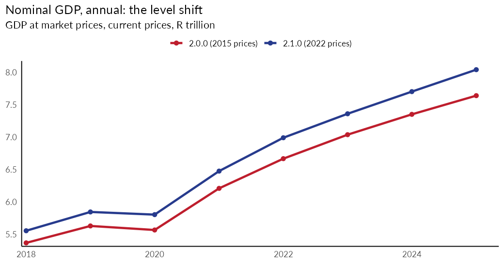
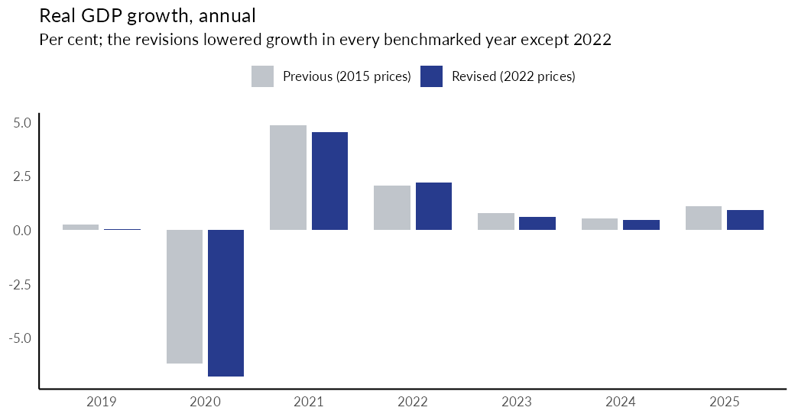
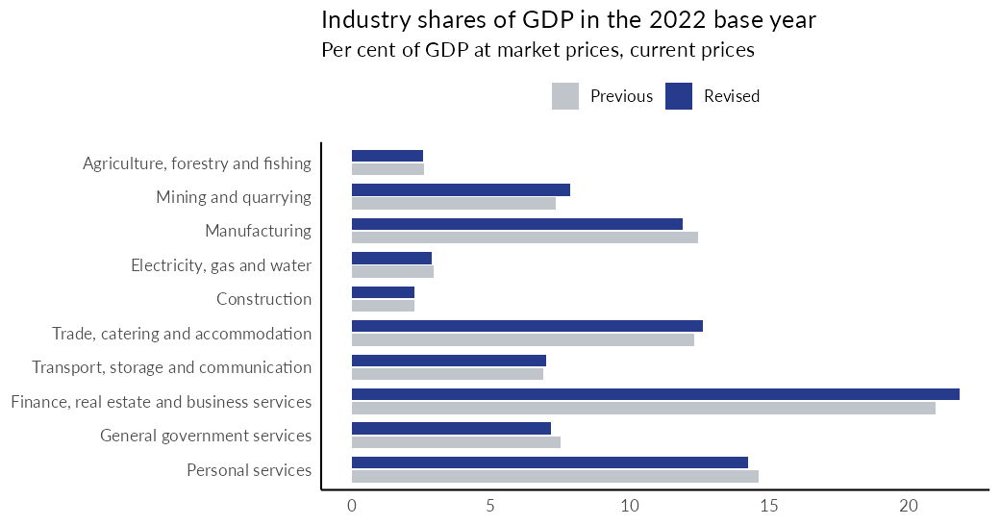
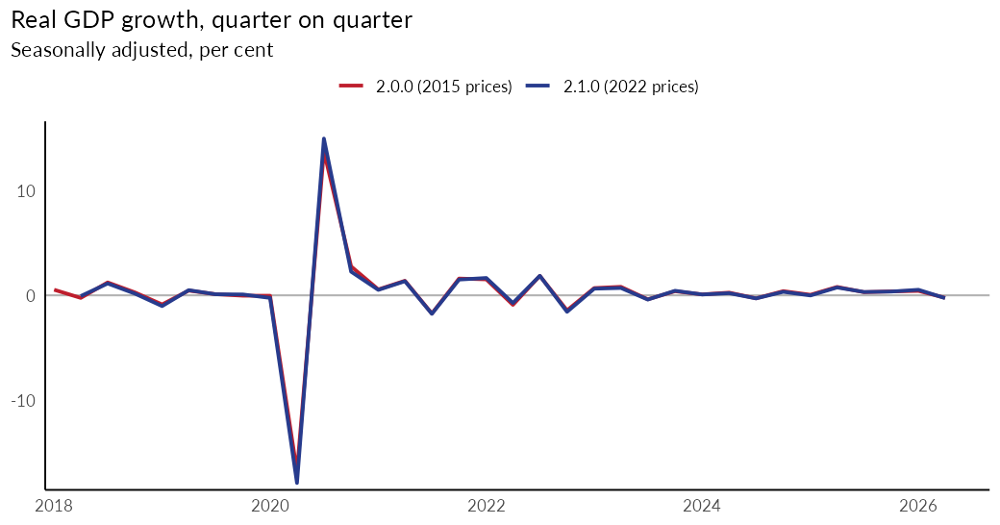
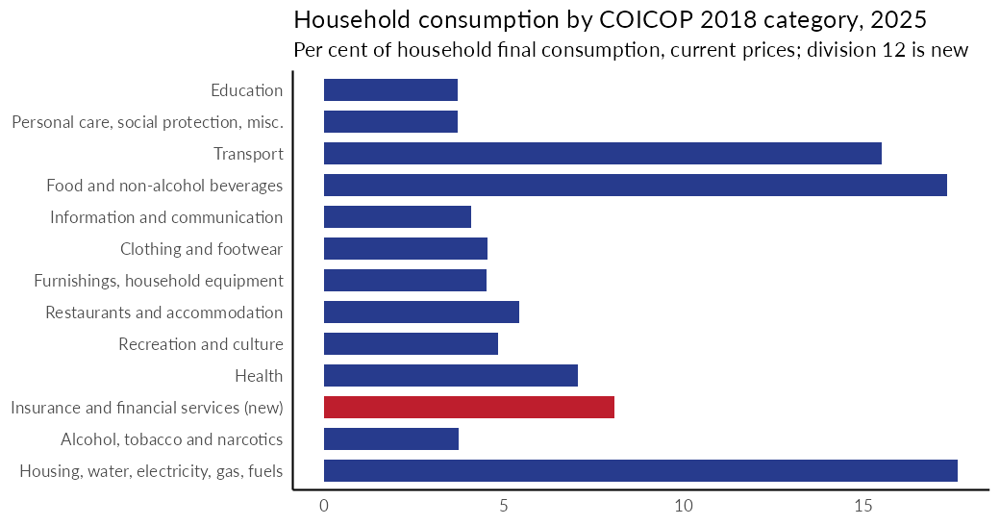

# South Africa's GDP, benchmarked and rebased to 2022

On 29 October 2026 Statistics South Africa (StatsSA) published benchmarked and rebased estimates of GDP (Report 04-04-04). Constant prices moved from a 2015 to a 2022 base, the source data were updated, and household consumption moved to the 2018 classification of individual consumption by purpose (COICOP 2018). EconData has the rebased series as version `2.1.0` of the dataset `NATL_ACC`. This post explains what changed, how to read the new data, and what to watch for.

A [validation report](https://storage.googleapis.com/codera-validation-public/NATL_ACC_2.1.0_rebase.html) compares what is on EconData with StatsSA's workbook and with the tables in StatsSA's press statement: every check passes.

## What changed

StatsSA benchmarks and rebases the national accounts roughly every five years. The 2026 exercise was delayed after the 2015 update because the pandemic years were not normal. It:

- raised the level of the 2022 economy by 4.9%, from R6 667 billion to R6 990 billion. The largest change was in mining (up 12.5%, because illegal mining is now measured) and in finance, real estate and business services (up 9.1%, from a new method for owner-occupied rent);
- lowered real growth in every benchmarked year except the 2022 base year. For 2020 growth went from -6.2% to -6.8%, and for 2025 from 1.1% to 0.9%;
- left the industry composition broadly unchanged: finance, real estate and business services is still the largest industry, at 21.8% of GDP;
- moved household consumption to COICOP 2018.







## Where it is on EconData

The dataset is `NATL_ACC`:

| Version | Prices | History | Use it for |
| --- | --- | --- | --- |
| `2.1.0` | constant 2022 | 2018 onwards (so far) | the rebased estimates |
| `2.0.0` | constant 2015 | 1993 to 2026Q2 | the earlier vintages, and anything that needs the long history |

The first vintage of `2.1.0` is `2026Q2 (2026-10-29)`. It holds 407 series: 98 annual series at current prices and 76 at constant prices, and 233 quarterly series. StatsSA has published the rebased time series from 2018 only. It has said that the back series to 1993 will follow in November 2026, and `2.1.0` will start in 1993 once it does. Until then, use `2.0.0` for anything before 2018, and remember that the two versions are on different bases and are not comparable in levels.

StatsSA's next release is the third quarter of 2026, on 1 December 2026. EconData will release it as the next vintage of `2.1.0`.

## Reading the data

```r
library(econdatar)

# Real GDP (constant 2022 prices), quarterly, seasonally adjusted and annualised
rgdp <- read_dataset("NATL_ACC", version = "2.1.0", series_key = "PROD.GDP.Q.R.S")

# Household consumption in every COICOP 2018 category, annual, current prices:
# an empty segment is a wildcard
hce <- read_dataset("NATL_ACC", version = "2.1.0", series_key = "HCE..A.N.N")

# The previous, 2015-based vintages
old <- read_dataset("NATL_ACC", version = "2.0.0", series_key = "PROD.GDP.Q.R.S")
```

The series key is `MNEMONIC.ACTIVITY.FREQ.PRICE_CONCEPT.SEASONAL_ADJUST`, and every key that existed in `2.0.0` is unchanged in `2.1.0`. `PROD.GDP.Q.R.S` is GDP at market prices, quarterly, constant prices, seasonally adjusted and annualised.

**A call without a version now returns `2.1.0`.** If your code reads `NATL_ACC` without a `version` argument, it now gets the rebased series, which start in 2018. Pin `version = "2.0.0"` if you need the 2015-based series or the long history, and pin `version = "2.1.0"` if you want to be sure of the rebased ones.



## Household consumption on COICOP 2018

COICOP 2018 has 13 divisions. Version `2.1.0` follows it, with these changes to the `ACTIVITY` codes of household consumption (`HCE`):

| Code | Version 2.0.0 | Version 2.1.0 |
| --- | --- | --- |
| `C08` | Communication | Information and communication |
| `C11` | Restaurants and hotels | Restaurants and accommodation services |
| `C12` | (not in use) | **Insurance and financial services** (new) |
| `C13` | Miscellaneous goods and services | **Personal care, social protection and miscellaneous goods and services** (narrower: insurance and financial services have moved to `C12`) |

The other nine categories keep their codes. The 13 categories add up to total household consumption (`HCE.ZA`), which the validation report checks.



## Other things to know

- **Source codes.** The `SOURCE_IDENTIFIER` attribute of each series now holds StatsSA's own series code (for example `AN1000`, annual GDP at current prices), and `ORIG_DATA_ID` holds the South African Reserve Bank's code for the same series (for example `KBP6006Y`) where the Reserve Bank publishes one. `ORIG_DATA_ID` is SDMX's "originator data identifier".
- **Corrections in the 2.0.0 series.** While building `2.1.0` we found three problems in the household consumption series of `2.0.0`: the quarterly series labelled "current prices, seasonally adjusted" for each household consumption category held the constant-price series; the household consumption of services series had no data; and the quarterly current-price series by category had no data. All three are fixed in `2.1.0`. `2.0.0` has not been changed.
- **Later revisions.** StatsSA has said that a new agriculture methodology is due in March 2027 and new seasonal factors in June 2027. EconData will keep each release as its own vintage.

Questions or corrections are welcome as issues or pull requests on this repository.
